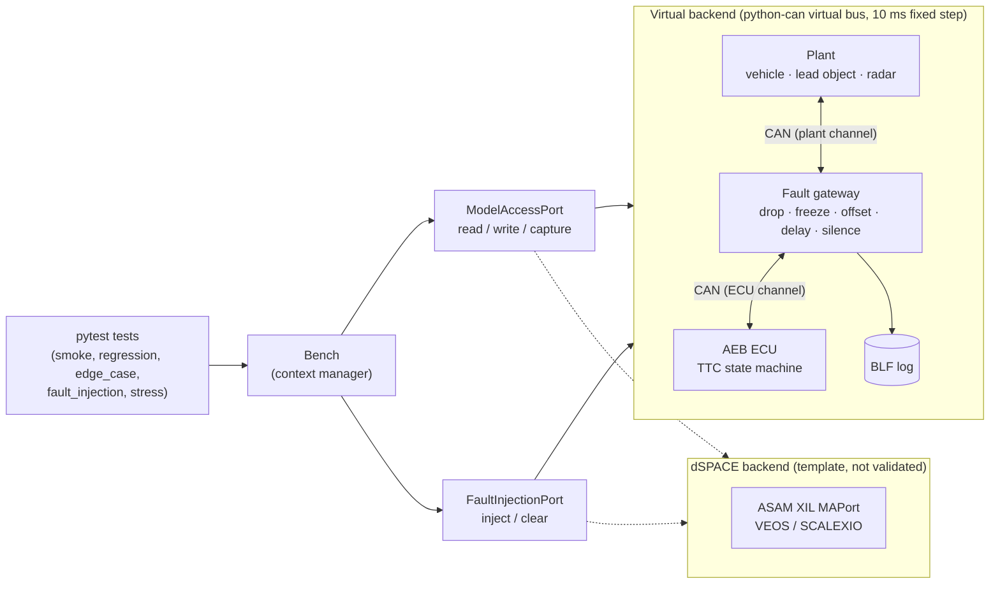

# mini-hil-bench


A small virtual **Hardware-in-the-Loop bench** for an **Automatic Emergency Braking (AEB) ECU**
on CAN. It includes a plant model (vehicle, lead object, radar), a virtual ECU, a CAN fault
gateway and an automated pytest framework with requirement traceability, BLF logs, plots and
CI on GitHub Actions. It shows the core work of a HIL / ADAS test engineer at a small scale:
bench design, plant modelling, CAN/DBC, test automation, fault injection, log analysis and CI/CD.

## Architecture



More detail is in [docs/architecture.md](docs/architecture.md).

## Quickstart

Requires Python 3.11+ and git.

**Linux / macOS**

```bash
git clone https://github.com/<your-github-user>/mini-hil-bench.git
cd mini-hil-bench
python3 -m venv .venv
source .venv/bin/activate
pip install -e ".[dev]"
pytest
```

**Windows (PowerShell)**

```powershell
git clone https://github.com/<your-github-user>/mini-hil-bench.git
cd mini-hil-bench
py -3 -m venv .venv
.venv\Scripts\Activate.ps1
pip install -e ".[dev]"
pytest
```

> Windows tip: if Pillow or matplotlib fails to import with "filename too long", the venv path
> is too deep. Clone into a shorter folder (e.g. `C:\dev\mini-hil-bench`) or create the venv in
> a shorter path.

## Running tests

```bash
pytest                         # everything (unit + system)
pytest -m smoke                # bench starts, traffic on all IDs, ECU reaches STANDBY
pytest -m regression           # nominal scenario per requirement
pytest -m edge_case            # boundary values (min speed, TTC thresholds, speed x distance)
pytest -m fault_injection      # radar timeout, frozen alive counter, offset, delay, invalid object
pytest -m stress               # bus load with filler frames
pytest tests/unit              # plant, ECU, CAN database and config unit tests
pytest --bench config/bench_virtual.toml   # choose the bench configuration
```

The simulation is deterministic: the same seed gives the same results on every run.

## Reports, logs and plots

```bash
pytest --html=reports/report.html --self-contained-html
```

* `reports/report.html` – test report with a **Requirements** column. Failed system tests
  have the scenario plot embedded.
* `reports/logs/<test>.blf` – all ECU-side CAN traffic with simulated timestamps. Open it with
  any BLF viewer, or use `mini_hil_bench.analysis.log_reader.read_blf`.
* `reports/plots/<test>.png` – ego speed, distance to object, AEB state and deceleration request.

On GitHub Actions the whole `reports/` folder is uploaded as an artifact on every run, even
when tests fail.

## Requirements

The AEB requirements (`REQ-AEB-001` … `REQ-AEB-008`), their acceptance criteria and the tests
that cover them are in [docs/requirements.md](docs/requirements.md). Tests are linked with
`@pytest.mark.req("REQ-AEB-00x")`.

## Configuration

`config/bench_virtual.toml` holds the scheduler step and seed, the plant parameters, the
ECU calibration (TTC thresholds, decelerations, diagnostics) and the **variable mapping** from
logical names used by tests to their sources (`model:` plant variables or `can:` DBC signals).

## dSPACE backend

`src/mini_hil_bench/bench/backends/dspace.py` shows how the same tests would run on a dSPACE
bench. The plant model and the ECU run on VEOS or a SCALEXIO system. `ModelAccessPort` maps
to an ASAM XIL MAPort, and the logical variables map to model paths in
`config/bench_dspace.toml` (e.g. `"Model Root/Vehicle/v_ego"`). Every method raises
`NotImplementedError` with `TODO`s that point to the official dSPACE documentation. No dSPACE
API is imported or guessed, and the factory refuses the `dspace` backend with a clear error.

**Not validated: no dSPACE license available. Interface and variable mapping are provided as a template.**

## Notes

* The DBC uses classic CAN for all messages. `AebCommand` is not marked as CAN FD, to keep
  the virtual bus, the BLF logs and the DBC simple.
* All internal values use SI units. km/h appears only in the DBC (`EgoSpeed`) and in the plots.

## License

[MIT](LICENSE)
